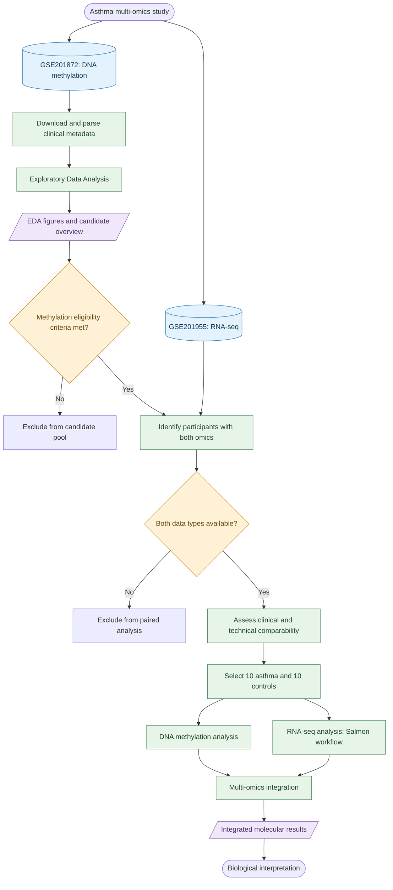
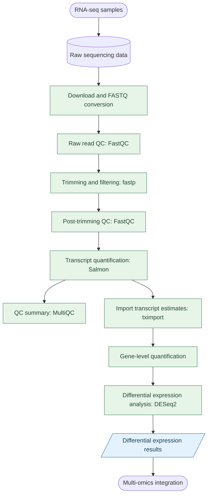
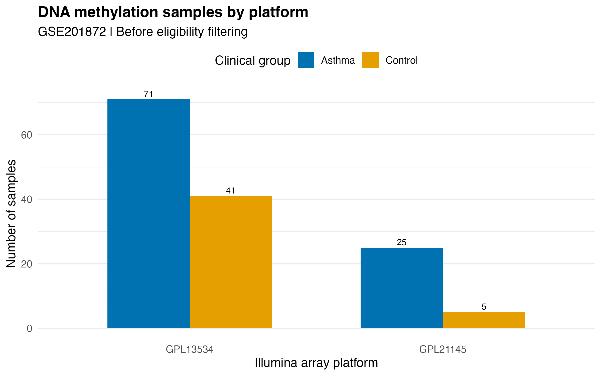
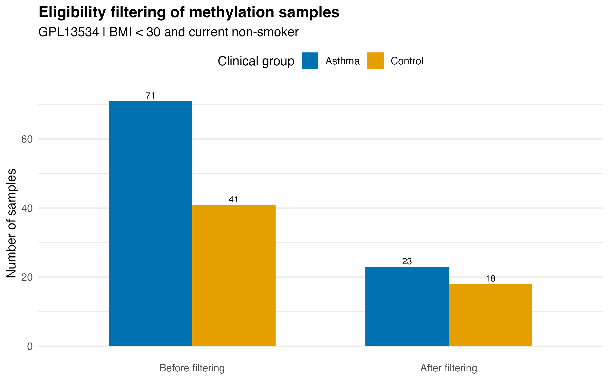
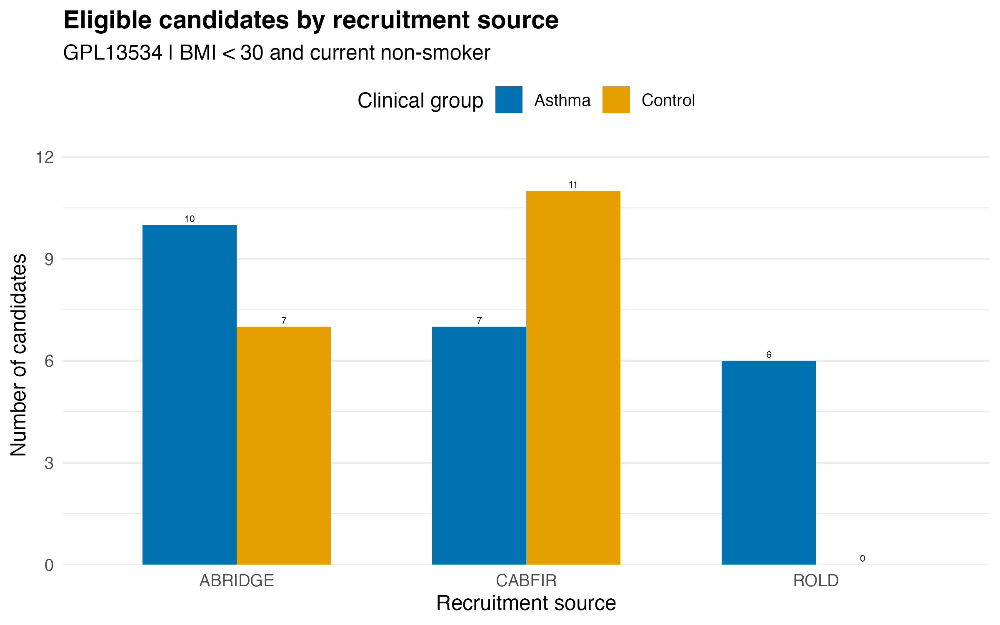
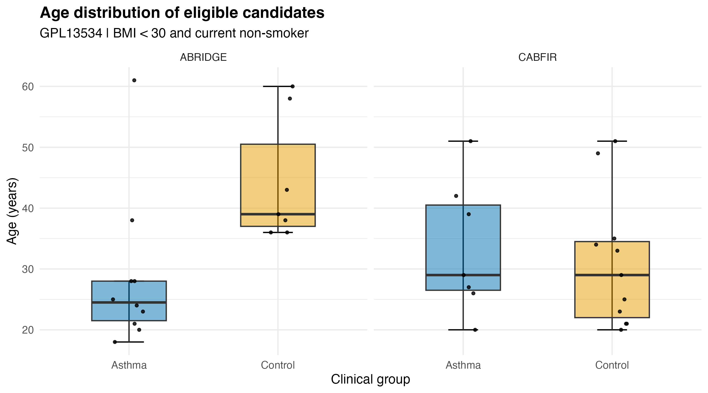
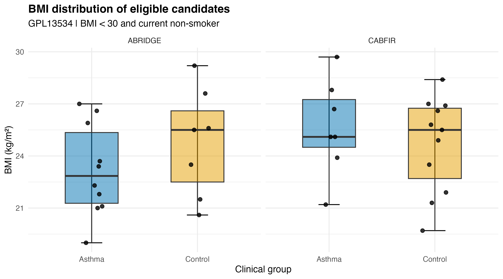
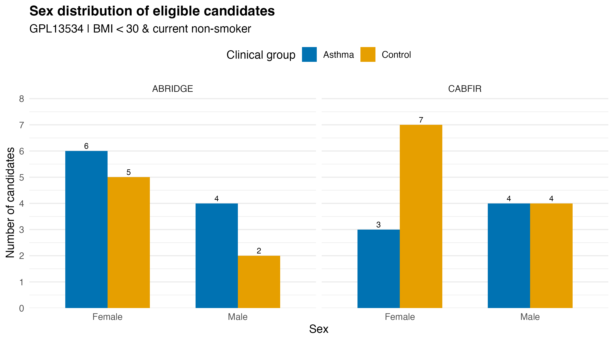
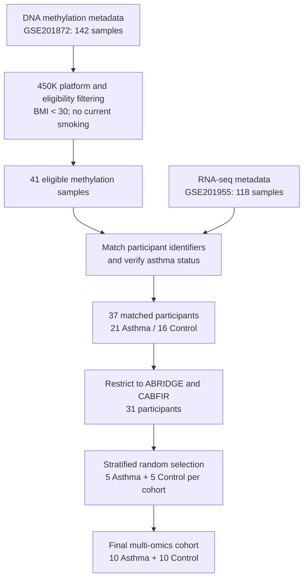

# Multi-Omics analysis of asthma

## Project overview
This project investigates asthma using an integrative multi-omics approach combining DNA methylation and RNA sequencing (RNA-seq) data.
The aim is to explore molecular differences between individuals with asthma and healthy controls and to investigate potential relationships between DNA methylation and gene expression.
The analysis is conducted in R, with an emphasis on reproducibility, transparent sample selection, and biological interpretation.

## Datasets
Publicly available datasets from the Gene Expression Omnibus (GEO) are used:
- **GSE201872:** DNA methylation data.
- **GSE201955:** RNA-seq data.
- **GSE210843:** SuperSeries linking the datasets.

## Study design
This study uses an integrative multi-omics approach to investigate the relationship between DNA methylation and gene expression in asthma.

### Possible research questions:
1. Do DNA methylation and gene expression patterns differ between eosinophilic and non-eosinophilic asthma phenotypes?
2. Are DNA methylation changes associated with altered expression of epithelial barrier genes in asthma?
3. Are DNA methylation changes associated with altered expression of airway remodeling genes in asthma?

### Study workflow

The following workflow summarizes the study design, from exploratory data analysis to the integration of DNA methylation and RNA-seq results.

### RNA-seq processing workflow

The RNA-seq analysis uses a Salmon-based transcript quantification approach rather than a conventional genome-alignment workflow.

---

## 1. Exploratory data analysis

### Objective
As part of the prepatory first phase I examined the clinical metadata and technical characteristics of the DNA methylation dataset (GSE201872).

The exploratory analysis aims to:
- Characterize the available samples and methylation platforms.
- Apply preliminary eligibility criteria.
- Examine recruitment source distributions.
- Compare age, BMI, and sex between asthma and control candidates.
- Assess the feasibility of selecting comparable groups for multi-omics analysis.

The analysis was performed in R using publicly available GEO metadata. R code can be found in the code depository.

### 1.1 DNA methylation platform distribution

GSE201872 contains 142 samples measured using two Illumina methylation platforms:

| Platform | Asthma | Control | Total |
|---|---:|---:|---:|
| GPL13534 (450K) | 71 | 41 | 112 |
| GPL21145 (EPIC) | 25 | 5 | 30 |
| **Total** | **96** | **46** | **142** |

The initial analysis focuses on GPL13534 to maintain consistency in the methylation platform.

### 1.2 Eligibility Filtering

The following preliminary eligibility criteria were applied:

- DNA methylation platform: GPL13534.
- BMI below 30 kg/m².
- Current non-smoker.

After filtering, 41 eligible methylation candidates remained:

| Clinical group | Before filtering | After filtering |
|---|---:|---:|
| Asthma | 71 | 23 |
| Control | 41 | 18 |
| **Total** | **112** | **41** |

### 1.3 Recruitment Source Distribution

The eligible methylation candidates originate from three recruitment sources.

| Recruitment source | Asthma | Control | Total |
|---|---:|---:|---:|
| ABRIDGE | 10 | 7 | 17 |
| CABFIR | 7 | 11 | 18 |
| ROLD | 6 | 0 | 6 |
| **Total** | **23** | **18** | **41** |

ABRIDGE and CABFIR contain both asthma and control candidates. ROLD contains no eligible controls.

Consequently, ABRIDGE and CABFIR are the principal recruitment sources considered for the paired study design.

### 1.4 Age Distribution

Age distributions were examined separately for ABRIDGE and CABFIR.

The boxplots show the distribution of ages within each clinical group, with individual observations displayed as points.

Age comparability is an important consideration when selecting participants for the integrated analysis.

### 1.5 BMI Distribution

BMI distributions were examined across clinical groups and recruitment sources.

All included candidates had a BMI below 30 kg/m², in accordance with the preliminary eligibility criteria.

### 1.6 Sex Distribution

Sex distributions were compared between asthma and control candidates within ABRIDGE and CABFIR.

| Recruitment source | Clinical group | Female | Male |
|---|---|---:|---:|
| ABRIDGE | Asthma | 6 | 4 |
| ABRIDGE | Control | 5 | 2 |
| CABFIR | Asthma | 3 | 4 |
| CABFIR | Control | 7 | 4 |

### 1.7 Exploratory analysis summary

The exploratory analysis identified 41 eligible DNA methylation candidates on GPL13534, comprising 23 individuals with asthma and 18 controls.
ABRIDGE and CABFIR provide candidates from both clinical groups, making them suitable sources for further sample selection.
The exploratory analysis also identified a technical consideration: among the eligible candidates, recruitment source and methylation batch are confounded. ABRIDGE candidates belong to batch 1, whereas CABFIR candidates belong to batch 2.
This relationship must be considered when interpreting downstream comparisons.
The selection of participants for multi-omics analysis additionally requires verification of sample overlap with GSE201955.

---

## 2. Sample selection
 
### Objective = integration of DNA methylation and RNA-seq metadata

DNA methylation metadata (GSE201872) and RNA-seq metadata (GSE201955) were obtained from the Gene Expression Omnibus (GEO).
The DNA methylation dataset was restricted to samples analyzed using the Illumina HumanMethylation450 BeadChip (GPL13534). Participants were considered eligible if they met the following criteria:

- Body mass index (BMI) < 30 kg/m²
- No current smoking (`current_smok == "No"`)
- Availability of DNA methylation data

These criteria resulted in **41 eligible DNA methylation samples**.
RNA-seq metadata contained **118 samples**. Participants were matched across the two datasets using the `geo_id` identifier in the methylation metadata and the `description` field in the RNA-seq metadata.
A total of **37 participants** had matching identifiers across both datasets, comprising 21 asthma patients and 16 controls.
Clinical metadata were compared across platforms to verify sample correspondence. Asthma status was concordant for all 37 matched participants, and no duplicate identifiers were detected. For the final selection, age, BMI, and current smoking status were also concordant across both datasets after harmonizing smoking status codes (`No`/`Yes` and `N`/`Y`).

### Final Sample Selection

A stratified random selection was performed using a fixed random seed (`set.seed(2026)`), selecting five asthma patients and five controls from each of the ABRIDGE and CABFIR recruitment cohorts.
This approach ensured equal representation of asthma patients and controls within each recruitment cohort and methylation batch. The ROLD cohort was excluded from the final selection because no eligible controls were available.

| Recruitment cohort | Methylation batch | Asthma | Control | Total |
|---|---|---:|---:|---:|
| ABRIDGE | 1 | 5 | 5 | 10 |
| CABFIR | 2 | 5 | 5 | 10 |
| **Total** | | **10** | **10** | **20** |

The selected participants had a mean age of 34.3 years in the asthma group and 34.0 years in the control group. Mean BMI was 24.5 and 24.0 kg/m², respectively.
All 20 selected participants met the BMI and current smoking criteria and had corresponding GEO sample accessions for both omics datasets.

### Sample Selection Workflow

### Reproducibility

Eligible DNA methylation candidates are saved as an RDS file by `code/01_download_metadata.R`.
The file is then loaded by `code/02_rnaseq_metadata.R` to identify participants with both DNA methylation and RNA-seq data.
A fixed random seed (`set.seed(2026)`) is used to make the selection reproducible. The final sample manifest is saved locally as a CSV file and is not included in the public repository.

The selection procedure and metadata validation are implemented in [`code/02_rnaseq_metadata.R`](code/02_rnaseq_metadata.R). The participant-level sample manifest is retained locally and is not included in the public repository.
 
## 3. DNA methylation analysis

## 4. RNA-seq analysis

## 5. Multi-omics integration

## 6. Discussion

---

## Reproducibility

The analysis is implemented in R.

### Source Code

The exploratory metadata analysis is available in:

[`code/01_download_metadata.R`](code/01_download_metadata.R)

### Figures

All exploratory figures are available in:

[`results/figures/`](results/figures/)

### Data Sources

- [GSE201872 — DNA methylation](https://www.ncbi.nlm.nih.gov/geo/query/acc.cgi?acc=GSE201872)
- [GSE201955 — RNA-seq](https://www.ncbi.nlm.nih.gov/geo/query/acc.cgi?acc=GSE201955)
- [GSE210843 — GEO SuperSeries](https://www.ncbi.nlm.nih.gov/geo/query/acc.cgi?acc=GSE210843)
