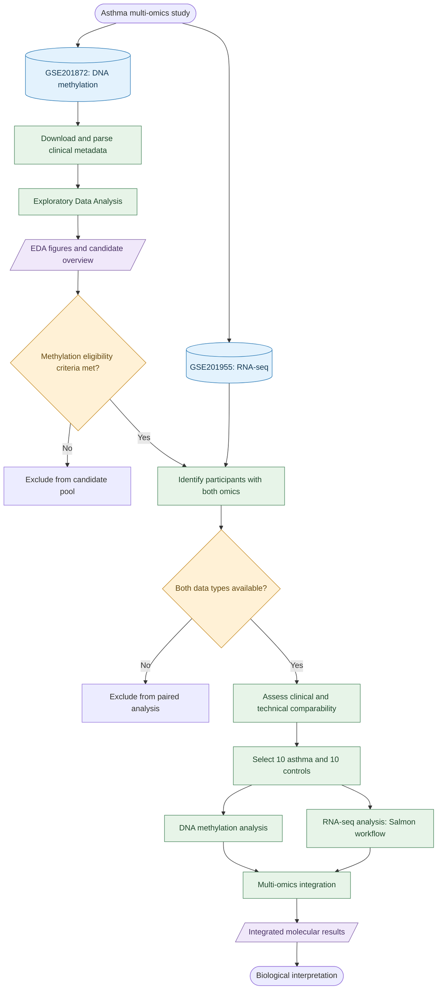
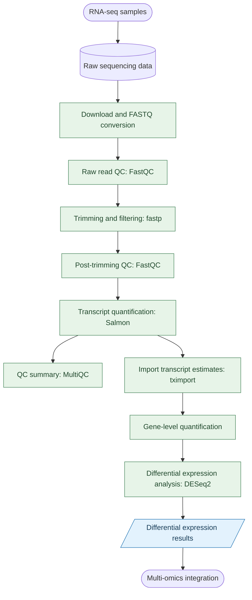
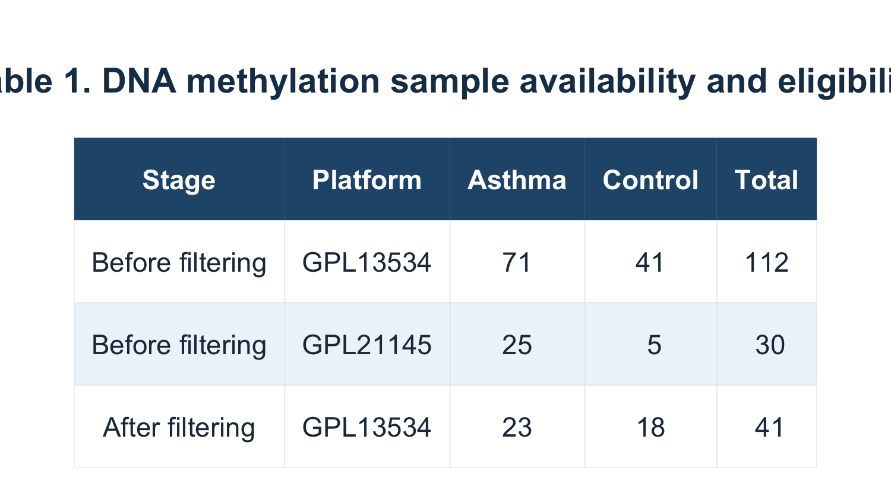
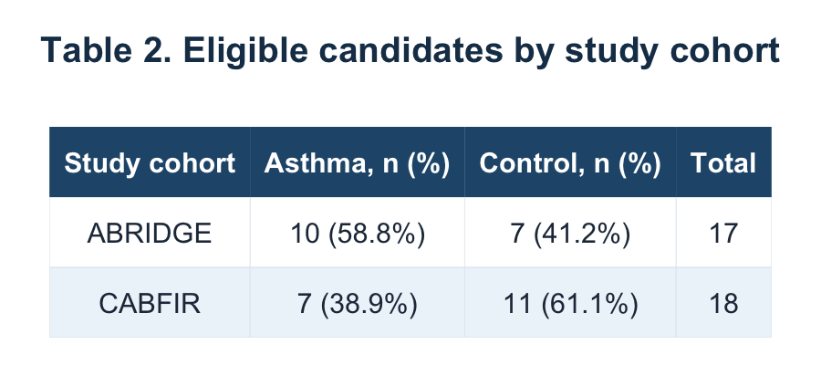
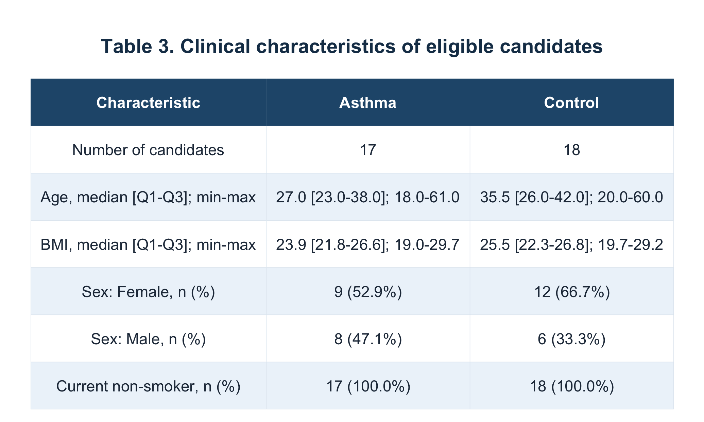
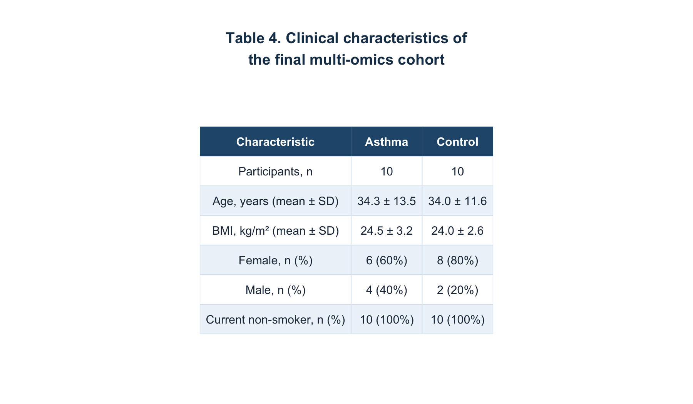
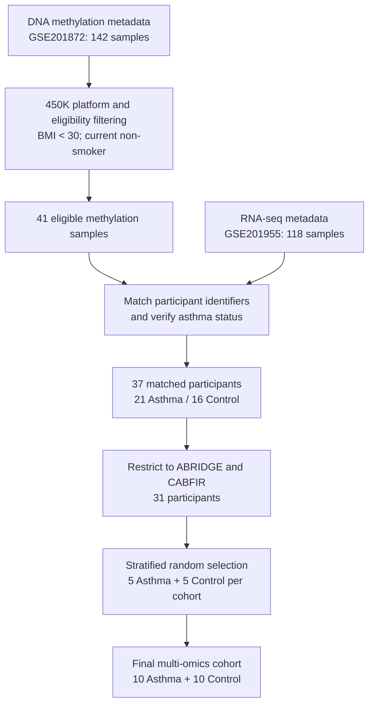
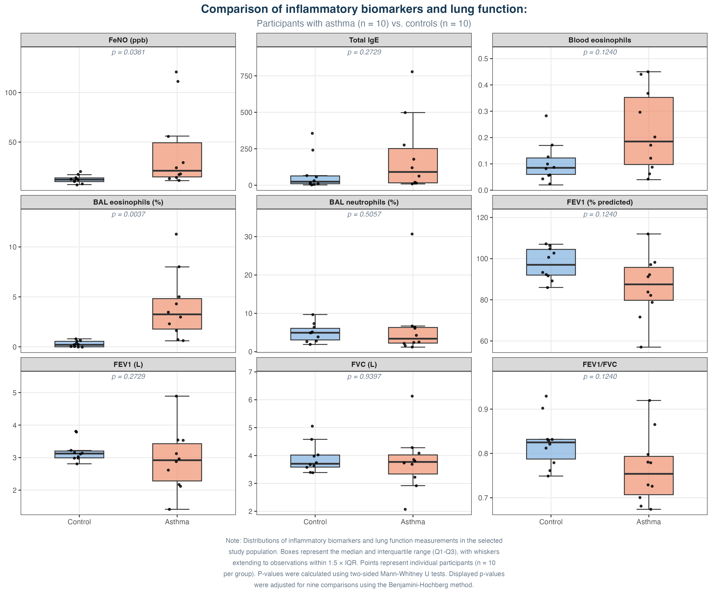
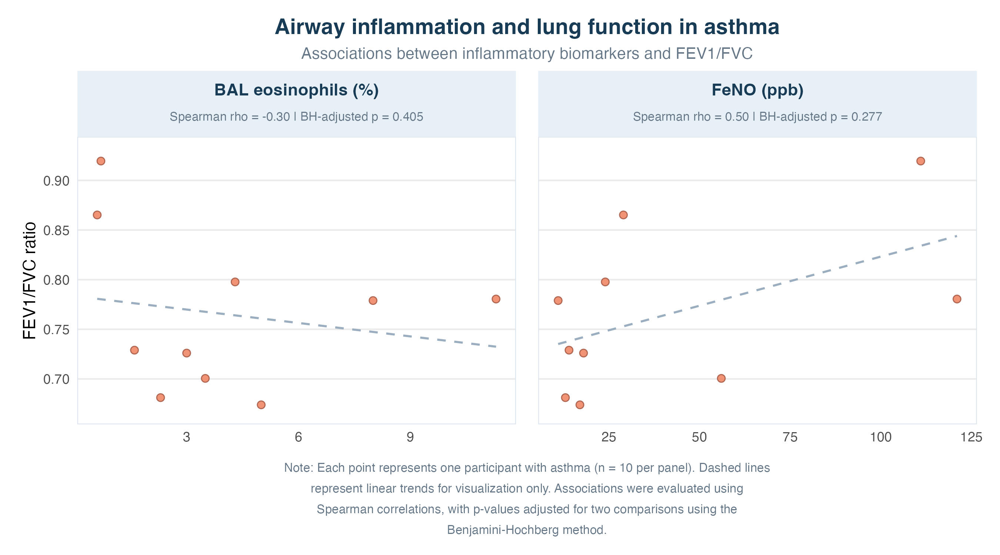

# Multi-Omics analysis of asthma

## Project overview

This project investigates asthma using an integrative multi-omics approach combining DNA methylation and RNA sequencing (RNA-seq) data.
The aim is to explore molecular differences between individuals with asthma and healthy controls and to investigate potential relationships between DNA methylation and gene expression.
The analysis is conducted in R, with an emphasis on reproducibility, transparent sample selection, and biological interpretation.

## Datasets

Publicly available datasets from the Gene Expression Omnibus (GEO) are used: - **GSE201872:** DNA methylation data.
- **GSE201955:** RNA-seq data.
- **GSE210843:** SuperSeries linking the datasets.

## Study design

This study uses an integrative multi-omics approach to investigate the relationship between DNA methylation and gene expression in epithelial barrier cells.

### Research question:

**Are DNA methylation changes associated with altered expression of epithelial barrier-related genes in asthma compared with healthy controls?** The analysis will focus on genes involved in maintaining bronchial epithelial barrier integrity, with candidate genes selected based on biological relevance and the available molecular data.

### Study workflow

The following workflow summarizes the study design, from exploratory data analysis to the integration of DNA methylation and RNA-seq results.

### RNA sequencing processing workflow

The RNA-seq analysis uses a Salmon-based transcript quantification approach rather than a conventional genome-alignment workflow.
The Salmon method was specifically chosen due to it's efficiency.

------------------------------------------------------------------------

## 1. Exploratory data analysis

### Objective

As part of the prepatory first phase I examined the clinical metadata and technical characteristics of the DNA methylation dataset (GSE201872).

The exploratory analysis aims to: - Characterize the available samples and methylation platforms.
- Apply preliminary eligibility criteria.
- Examine study distributions.
- Compare age, BMI, and sex between asthma and control candidates.
- Assess the feasibility of selecting comparable groups for multi-omics analysis.

The analysis was performed in R using publicly available GEO metadata.
R code can be found in the code depository.

### DNA methylation platform distribution

GSE201872 contains 142 samples measured using two Illumina methylation platforms:

| Platform        | Asthma | Control |   Total |
|-----------------|-------:|--------:|--------:|
| GPL13534 (450K) |     71 |      41 |     112 |
| GPL21145 (EPIC) |     25 |       5 |      30 |
| **Total**       | **96** |  **46** | **142** |

The initial analysis focuses on GPL13534 to maintain consistency in the methylation platform.

### Eligibility Filtering

The following preliminary eligibility criteria were applied:

-   DNA methylation platform: GPL13534.
-   BMI below 30 kg/m².
-   Current non-smoker.

After filtering, 41 eligible methylation candidates remained:

| Clinical group | Before filtering | After filtering |
|----------------|-----------------:|----------------:|
| Asthma         |               71 |              23 |
| Control        |               41 |              18 |
| **Total**      |          **112** |          **41** |

<!-- Table 1: DNA methylation sample availability -->

### Study group distribution

The 41 eligible methylation candidates originated from three study cohorts: ABRIDGE (n = 17), CABFIR (n = 18), and ROLD (n = 6).
ABRIDGE and CABFIR included both asthma and control candidates, whereas ROLD contained only asthma candidates (n = 6).
Consequently, ABRIDGE and CABFIR were considered for the paired study design.
The distribution of eligible candidates across these two study cohorts is presented in Table 2.

<!-- Table 2: Study cohort distribution -->

### Age Distribution

Age distributions were examined separately for ABRIDGE and CABFIR.
The boxplots show the distribution of ages within each clinical group, with individual observations displayed as points.
Age comparability is an important consideration when selecting participants for the integrated analysis.

### BMI Distribution

BMI distributions were examined across clinical groups and studies.
All included candidates had a BMI below 30 kg/m², in accordance with the preliminary eligibility criteria.

### 1.6 Sex Distribution

Sex distributions were compared between asthma and control candidates within ABRIDGE and CABFIR.

| Study   | Clinical group | Female | Male |
|---------|----------------|-------:|-----:|
| ABRIDGE | Asthma         |      6 |    4 |
| ABRIDGE | Control        |      5 |    2 |
| CABFIR  | Asthma         |      3 |    4 |
| CABFIR  | Control        |      7 |    4 |

<!-- Table 3: Clinical characteristics -->

### Exploratory analysis summary

The exploratory analysis identified 41 eligible DNA methylation candidates on GPL13534, comprising 23 individuals with asthma and 18 controls.
ABRIDGE and CABFIR provide candidates from both clinical groups, making them suitable sources for further sample selection.
The exploratory analysis also identified a technical consideration: among the eligible candidates, study (recruitment source) and methylation batch are confounded.
ABRIDGE candidates belong to batch 1, whereas CABFIR candidates belong to batch 2.
This relationship must be considered when interpreting downstream comparisons.
The selection of participants for multi-omics analysis additionally requires verification of sample overlap with GSE201955.

------------------------------------------------------------------------

## 2. Sample selection

### Objective = integration of DNA methylation and RNA-seq metadata

DNA methylation metadata (GSE201872) and RNA-seq metadata (GSE201955) were obtained from the Gene Expression Omnibus (GEO).
The DNA methylation dataset was restricted to samples analyzed using the Illumina HumanMethylation450 BeadChip (GPL13534).
Participants were considered eligible if they met the following criteria:

-   Body mass index (BMI) \< 30 kg/m²
-   Current non-smoker (`current_smok == "No"`)
-   Availability of DNA methylation data

These criteria resulted in **41 eligible DNA methylation samples**.
RNA-seq metadata contained **118 samples**.
Participants were matched across the two datasets using the `geo_id` identifier in the methylation metadata and the `description` field in the RNA-seq metadata.
A total of **37 participants** had matching identifiers across both datasets, comprising 21 asthma patients and 16 controls.
Clinical metadata were compared across platforms to verify sample correspondence.
Asthma status was concordant for all 37 matched participants, and no duplicate identifiers were detected.
For the final selection, age, BMI, and current smoking status were also concordant across both datasets after harmonizing smoking status codes (`No`/`Yes` and `N`/`Y`).

### Final Sample Selection

A stratified random selection was performed using a fixed random seed (`set.seed(2026)`), selecting five asthma patients and five controls from each of the ABRIDGE and CABFIR study cohorts.
This approach ensured equal representation of asthma patients and controls within each study cohort and methylation batch.
The ROLD cohort was excluded from the final selection because no eligible controls were available.

| Study cohort | Methylation batch | Asthma | Control |  Total |
|--------------|-------------------|-------:|--------:|-------:|
| ABRIDGE      | 1                 |      5 |       5 |     10 |
| CABFIR       | 2                 |      5 |       5 |     10 |
| **Total**    |                   | **10** |  **10** | **20** |

The clinical characteristics of the 20 selected participants are summarized in Table 4, allowing comparison of age, sex, BMI, and current smoking status between the asthma and control groups.

All 20 selected participants met the eligibility criteria and had corresponding GEO sample accessions for both DNA methylation and RNA-seq.
Maternal asthma status was also included in the sample manifest, using the original GEO metadata.

### Sample Selection Workflow

### Reproducibility

Eligible DNA methylation candidates are saved as an RDS file by `code/01_download_metadata.R`.
The file is then loaded by `code/02_rnaseq_metadata.R` to identify participants with both DNA methylation and RNA-seq data.
A fixed random seed (`set.seed(2026)`) is used to make the selection reproducible.
The final sample manifest is saved locally as a CSV file and is not included in the public repository.
The selection procedure and metadata validation are implemented in [`code/02_rnaseq_metadata.R`](code/02_rnaseq_metadata.R).
The participant-level sample manifest is retained locally and is not included in the public repository.

## 3. Clinical exploratory data analysis of the selected cohort

### Clinical variables

A clinical exploratory data analysis (EDA) was performed to characterize the final study group of 20 participant and investigate differences in airway inflammation and lung function between the two cohorts (asthma vs. control).
The analysis focused on demographic characteristics, inflammatory biomarkers, and pulmonary function measurements obtained from the publicly available GEO metadata.

The following clinical measurements were taken into account: \| Category \| Variable \| Description \| \|---\|---\|---\| \| Demographic \| Age \| Participant age \| \| Demographic \| Sex \| Recorded biological sex \| \| Anthropometric \| BMI \| Body mass index \| \| Inflammatory \| FeNO \| Fractional exhaled nitric oxide \| \| Inflammatory \| Total IgE \| Total serum immunoglobulin E \| \| Inflammatory \| Blood eosinophils \| Peripheral blood eosinophil count \| \| Inflammatory \| BAL eosinophils \| Eosinophils in bronchoalveolar lavage \| \| Inflammatory \| BAL neutrophils \| Neutrophils in bronchoalveolar lavage \| \| Lung function \| FEV1 \| Forced expiratory volume in one second \| \| Lung function \| FEV1 (% predicted) \| FEV1 relative to the predicted reference value \| \| Lung function \| FVC \| Forced vital capacity \| \| Lung function \| FEV1/FVC \| Ratio between FEV1 and FVC \|

BAL differential cell measurements were converted from proportions to percentages for interpretation and visualization.

These clinical variables were selected to characterize the inflammatory and physiological profiles of the study population and to provide context for subsequent molecular analyses.
Recruitment cohort, methylation batch, and ancestry-related variables were also considered as potential sources of confounding.

### Descriptive analysis

Descriptive statistics were calculated separately for participants with asthma and healthy controls.
Continuous variables were summarized using medians, interquartile ranges (IQR), and observed ranges.
Their distributions were visualized using boxplots with individual participant observations.

Boxplots represent the median and interquartile range, with whiskers extending to observations within 1.5 times the IQR.
Individual data points were included to illustrate variability within the relatively small study groups.

Missing measurements were excluded from analyses requiring the corresponding variable.

### Statistical methods

Differences in inflammatory biomarkers and pulmonary function measurements between participants with asthma and controls were evaluated using two-sided Wilcoxon rank-sum tests (Mann–Whitney U tests).

This non-parametric approach was selected because of the small sample size and the potential for non-normally distributed clinical measurements.

Nine clinical measurements were compared between the groups.
To account for multiple testing, p-values were adjusted using the Benjamini–Hochberg (BH) false discovery rate procedure.

Additionally, associations between airway inflammation and lung function were explored within the asthma group (n = 10).
Spearman rank correlations were calculated between FeNO or BAL eosinophils and the FEV1/FVC ratio.
P-values were adjusted for the two correlation tests using the BH method.

All statistical analyses were performed in R.
The results were interpreted as exploratory, with particular consideration of the limited sample size.

### Comparison of inflammatory biomarkers and lung function

Nine clinical measurements were compared between the asthma and healthy control groups to investigate differences in airway inflammation and pulmonary function.

### Exploratory inflammatory phenotyping

Inflammatory biomarkers, including BAL eosinophils, BAL neutrophils, blood eosinophils, FeNO, and total IgE, were selected for further exploration of asthma-associated inflammatory profiles.
Potential eosinophilic and non-eosinophilic phenotypes will be evaluated using biologically justified definitions and the available participant-level measurements.
No phenotype classification is assumed at this stage.

### Analytical considerations

Because the selected cohort contains only 10 participants with asthma and 10 controls, statistical power is limited.
Results are therefore interpreted as exploratory and hypothesis-generating.
Potential confounding factors, including demographic characteristics, recruitment source, batch, and genetic ancestry, will be considered when designing subsequent differential expression and DNA methylation analyses.
The clinical EDA was performed in R using reproducible scripts maintained in the project repository.

## Clinical characteristics and distribution

### Inflammatory biomarkers and long function

The following nine clinical measurements were initially compared between the participants of the final study population: FeNO, total serum IgE, blood eosinophils, BAL eosinophils, BAL neutrophils, FEV1 (% predicted), FEV1, FVC, and the FEV1/FVC ratio.
Distributions were visualized using boxplots, group differences were calculated using two-sided Mann-Whitney U tests, which was followed by Benjamini-Hochberg correction for the 9 comparisons.

\*\*Figure 8: Distribution of biomarkers and pulmonary function measured in participants with asthma and healthy controls.
Individual observations are displayed alongside boxplots.
Statistical comparisons were performed using two-sided Mann–Whitney U tests, with Benjamini–Hochberg correction for nine comparisons.

| Clinical measurement | Raw p-value | BH-adjusted p-value |
|----------------------|------------:|--------------------:|
| FeNO                 |     0.00803 |              0.0361 |
| Total serum IgE      |       0.212 |              0.2729 |
| Blood eosinophils    |      0.0689 |              0.1240 |
| BAL eosinophils      |    0.000408 |              0.0037 |
| BAL neutrophils      |       0.450 |              0.5057 |
| FEV1 (% predicted)   |      0.0636 |              0.1240 |
| FEV1                 |       0.212 |              0.2729 |
| FVC                  |       0.940 |              0.9397 |
| FEV1/FVC             |       0.064 |              0.1240 |

FeNO and BAL eosinophil levels were significantly higher in participants with asthma compared with controls after correction for multiple testing (BH-adjusted p = 0.0361 and 0.0037, respectively).

These findings are consistent with increased eosinophilic airway inflammation being present with asthma.

Although total serum IgE tended to be higher and FEV1 (% predicted) tended to be lower among participants with asthma, these differences were not statistically significant after multiple-testing correction.

Blood eosinophil levels showed substantial overlap between both groups, while the remaining pulmonary function measurements did not seem to be statistically significant different.

Overall, FeNO and BAL eosinophils were observed to be the most clearly differentiated inflammatory measurements between the groups.
However, these clinical differences do not directly establish alterations in bronchial epithelial barrier function.

### Associations between airway inflammation and lung function

To further explore the relationship between airway inflammation and pulmonary function, Spearman correlations were calculated within the asthma group.
Two inflammatory measurements, FeNO and BAL eosinophils, were evaluated in relation to the FEV1/FVC ratio, which provides an indication of airflow limitation.

\*\*Figure 9: Associations between FeNO or BAL eosinophils and FEV1/FVC among participants with asthma.
Spearman correlation coefficients were calculated using available observations, and p-values were adjusted for two comparisons using the Benjamini–Hochberg method.
Dashed lines represent linear trends for visualization.

FeNO showed a positive correlation with FEV1/FVC, whereas BAL eosinophils showed a negative correlation.
Neither association was statistically significant aftercorrection.
Given the small number of participants with asthma (n = 10), these findings should be interpreted as exploratory and do not establish the absence of biologically relevant associations between airway inflammation and lung function.

### Analytical considerations

The clinical EDA provides an initial characterization of the selected multi-omics cohort and identifies inflammatory differences that may be relevant for the following molecular analyses.

However, several limitations should be considered.
First, the relatively small study population (10 asthma and 10 controls) limits statistical power, particularly for correlation analyses performed within the asthma group.
Second, recruitment cohort and methylation batch are confounded in the available data: ABRIDGE participants belong to methylation batch 1, whereas CABFIR participants belong to batch 2.
Although asthma and control samples were selected in equal numbers from both cohorts, recruitment and batch effects cannot be independently distinguished.

Additional potential sources of variation include demographic characteristics, ancestry, and differences in clinical measurements between participants.

The observed differences in FeNO and BAL eosinophils provide useful information about the inflammatory characteristics of the cohort.
Nevertheless, clinical measurements alone cannot determine whether DNA methylation or gene expression changes affect bronchial epithelial barrier integrity.

These findings therefore serve as clinical context for the primary research question, which will be investigated through the integration of DNA methylation and RNA-seq data.

## 4. RNA-seq analysis

### RNA-seq preprocessing and quality control

RNA-seq data from 20 selected participants (10 asthma and 10 controls) were processed using a reproducible workflow implemented in Bash.
The selected samples correspond to the matched multi-omics cohort described in Section 2.
Initial sequence quality was assessed using FastQC and MultiQC.
The single-end sequencing reads were approximately 50–51 bp long, with several samples showing reduced read quality, overrepresented sequences, and elevated ambiguous nucleotide content.
Preprocessing was performed using fastp followed by targeted adapter and primer trimming with Cutadapt.
Reads were restricted to a maximum length of 50 bp, and a minimum retained length of 31 bp was applied.
Alternative quality-trimming settings were evaluated but did not provide sufficient improvements to justify additional read loss.
The final preprocessing strategy was selected to balance sequence quality and read retention.
Post-processing quality control was repeated using FastQC and MultiQC.
Adapter-related failures were resolved across the 20 samples, although residual sequence-content and ambiguous-base warnings remained in some libraries.
These findings will be considered when evaluating transcript quantification performance.
Notably, SRR19020907 showed substantial read loss during preprocessing and required particular attention during downstream quality assessment.

### Salmon reference indexing

Transcript quantification was prepared using Salmon v2.8.0 and the Ensembl release 115 human reference (GRCh38).
A full decoy-aware index was constructed by combining the transcriptome with the primary genome assembly.

| Parameter                         | Configuration                        |
|-----------------------------------|--------------------------------------|
| Reference genome                  | GRCh38                               |
| Ensembl release                   | 115                                  |
| Quantification tool               | Salmon 2.8.0                         |
| Index strategy                    | Full decoy-aware selective alignment |
| k-mer length                      | 21                                   |
| Minimizer length                  | 15                                   |
| Number of decoy sequences         | 194                                  |
| Total indexed reference sequences | 315,988                              |

The completed index is stored under `data/references/indexes/salmon/salmon_GRCh38_115_decoy_k21/`.

### Current analysis status

All 20 selected RNA-seq samples have completed FASTQ preprocessing and final sequence quality assessment.
The full decoy-aware Salmon index has also been successfully generated and validated using its index metadata.
Transcript quantification has not yet been completed.
An initial test on a computer with 8 GB RAM encountered substantial memory pressure while loading the 12 GB index.
Quantification is therefore planned on a laboratory workstation with sufficient memory.
After quantification, mapping statistics and library-specific quality metrics will be assessed before transcript-level estimates are imported into R for differential expression analysis using tximport and DESeq2.

## 5. DNA methylation analysis

## 6. Multi-omics integration

## 7. Discussion

------------------------------------------------------------------------

## Reproducibility

The analysis is implemented in R.

### Source Code

The exploratory metadata analysis is available in:

[`code/01_download_metadata.R`](code/01_download_metadata.R) [`code/02_rnaseq_metadata.R`](code/02_rnaseq_metadata.R)

### Descriptive tables

The exploratory analysis results are presented as three descriptive tables:

-   **Table 1:** DNA methylation sample availability and eligibility.
-   **Table 2:** Eligible candidates by study cohort.
-   **Table 3:** Clinical characteristics of eligible candidates.

The tables are available as PNG images and CSV files in:

[`results/tables/`](results/tables/)

### Data Sources

-   [GSE201872 — DNA methylation](https://www.ncbi.nlm.nih.gov/geo/query/acc.cgi?acc=GSE201872)
-   [GSE201955 — RNA-seq](https://www.ncbi.nlm.nih.gov/geo/query/acc.cgi?acc=GSE201955)
-   [GSE210843 — GEO SuperSeries](https://www.ncbi.nlm.nih.gov/geo/query/acc.cgi?acc=GSE210843)

### References

-   (<https://www.plotstudio.ai/articles/r-programming-for-statistical-analysis>)
-   (<https://www.geeksforgeeks.org/r-language/overview-of-statistical-analysis-in-r/>)
-   (<https://www.geeksforgeeks.org/r-language/mann-whitney-u-test-in-r-programming/>)
-   (<https://www.geeksforgeeks.org/r-language/kruskal-wallis-test-in-r-programming/>)
-   
